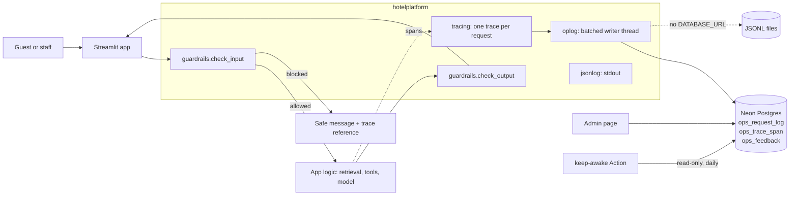
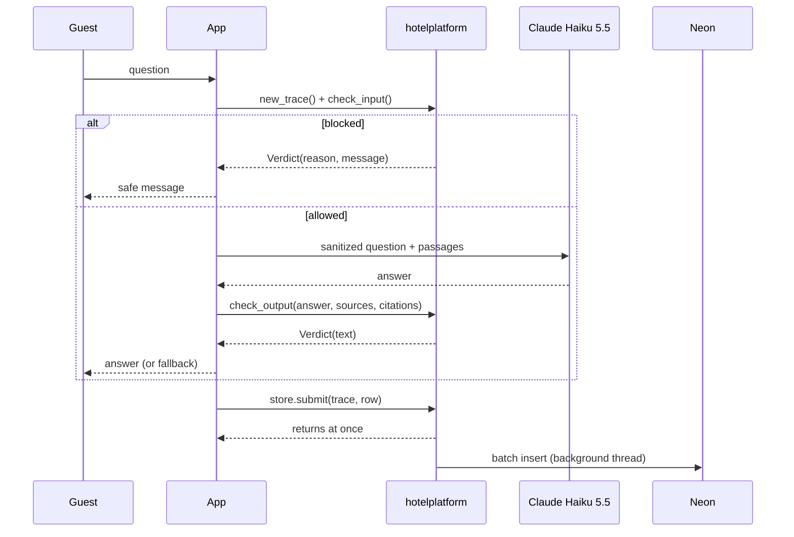

# Hotel AI Platform

[](https://github.com/vamsialladev/hotel-ai-platform/actions/workflows/ci.yml)


[](LICENSE)

The guardrails, PII redaction, request tracing, request log and Admin page that every hotel AI app shares. One
tested copy instead of seven.

Part of a **simulated client engagement** for a fictional hotel group (Beach Resort, Mountain Lodge). All data is
synthetic. This is a support library, like `streamlit-keep-awake`, so it has no stage number of its own.

<!-- DEMO-VIDEO -->

**▶ Try it live:** it's a library, so there's no app of its own. You can see it working in the [Knowledge Assistant](https://hotel-ops-assistant.streamlit.app) and the [Guest Request Agent](https://guest-request-agent.streamlit.app) (free hosting: may take ~30 s to wake).

## At a glance

| | |
|---|---|
| Problem | Seven apps each grew their own PII scrubber, injection patterns and log format. A fix in one never reached the others. |
| Solution | One standard-library package, pinned by tag in every app: input and output guardrails, tracing, a shared Neon log, one Admin page. |
| Measured quality | 123 tests, 95% coverage. Shared red-team corpus 48/48 (40 attacks stopped, 0 of 8 benign controls blocked); 0 of 383 real eval inputs from the apps wrongly blocked; see [docs/RED_TEAM.md](docs/RED_TEAM.md) for why that number flatters. |
| Cost | $0 per request. Every check is a regular expression or a checksum: no model, no network. |

## The problem

I had the same `src/pii.py` copied into five repos. Then each app needed injection patterns, a trace ID on errors,
a request log and an Admin page. Copying all of that seven times is how you end up with seven slightly different
security postures. So I pulled the shared parts out into one package that each app installs at a pinned tag.

## What it does

| Module | What it's for |
|---|---|
| `guardrails` | `check_input()`: empty, length, language, injection and jailbreak patterns, PII (cards and IDs blocked, contact details replaced), off-topic. `check_output()`: citation required, numbers grounded in the sources, PII leaks, promises only staff can make, off-brand text, prompt leaks. |
| `injection` | Direct attack patterns in 6 categories, plus `quarantine()` for planted instructions in documents, emails and tool results. |
| `pii` | Presidio-style detection (same entity names, Luhn and mod-97 checksums) and the redaction the apps have used since Project 4. |
| `tracing` | OpenTelemetry-shaped traces and spans: 32-hex trace ID, 16-hex span IDs, parents, durations, status. Redacted when stored. |
| `oplog` | `ops_request_log`, `ops_trace_span`, `ops_feedback` in Postgres (Neon), SQLite or JSONL files. Batched background writes; never blocks or breaks a request. 30-day retention. |
| `jsonlog` | One JSON line per event, same format in every app: app start + version, config loaded (set/missing only), dependency health, caps, retries, slow requests, redacted exceptions. |
| `admin_gate`, `admin_ui` | `ADMIN_PASSWORD` gate (5 wrong tries locks it for 15 minutes, across tabs), and the Admin page: totals, error rate, p50/p95, cost vs caps, failures filter, per-request waterfall, top errors, guardrail blocks, system health, CSV. |
| `bots` | `?source=keepawake` visits skip the model, the log and the database. |
| `redteam` | Case format, runner, report, and a shared corpus of 48 cases. |
| `daily_summary`, `retention` | The daily failure check (run by streamlit-keep-awake's Action) and a purge script. |

## Architecture





More in [docs/ARCHITECTURE.md](docs/ARCHITECTURE.md).

## Results

- Tests: 123 passed, 95% line coverage (`pytest --cov`).
- Shared red-team corpus: 48/48. I wrote those cases while writing the patterns, so treat it as a regression
  floor, not a measure of real-world robustness. The per-app suites and their held-out cases are the real test.
- One real bug the tests caught: PII scrubbing ran before secret masking, and the phone pattern broke the shape
  of an API key so the secret masker no longer recognised it. Secrets are now masked first (decision 4).

## Business value

Who benefits: the hotel group's IT and security reviewers, who now review one set of rules instead of seven. Time
saved is a projection: a security fix lands once and every app picks it up on its next pin bump. In a pilot I'd
measure it by counting how many apps pick up a guardrail fix within a week.

## Design at scale

- **Model choice:** none. Guardrails are deterministic on purpose: free, fast (well under a millisecond per
  check), explainable to a reviewer. A model-based classifier would be a second layer (Roadmap).
- **PII and tenant isolation:** PII removed before a row is queued. The `app` column separates apps; per-hotel
  isolation stays in each app (stage 7's MCP server enforces it in tools).
- **10K → 1M users:** first thing to break is the single writer thread per process and the shared free Neon
  database. Fix: an OpenTelemetry exporter to a collector, and a time-partitioned table (or a log service).
- **Observability:** every request has a trace; blocks are log lines with trace ID and reason; Admin shows the
  waterfall; a daily Action checks error rates.
- **Failure modes and rollback:** the database down → rows go to a local file and a counter goes up; the request
  is unaffected. Apps pin a tag, so rolling back is changing one line in `requirements.txt`.

## Security & guardrails

See [SECURITY.md](SECURITY.md): STRIDE threat model, OWASP LLM Top 10 mapping, data classification, incident
response.

## Run locally

Windows (PowerShell):

```powershell
py -3.12 -m venv .venv
.venv\Scripts\Activate.ps1
pip install -r requirements-dev.txt
python -m pytest
python -m hotelplatform.redteam
```

macOS / Linux: the same with `python3.12 -m venv .venv` and `source .venv/bin/activate`.

In an app's `requirements.txt`:

```text
hotel-ai-platform[postgres] @ https://github.com/vamsialladev/hotel-ai-platform/archive/refs/tags/v0.1.0.zip
```

## Limitations & roadmap

- Pattern-based detection misses paraphrases and other languages (English and Spanish covered). Roadmap: a small
  classifier as a second layer, measured on held-out attacks.
- Names in free text are found only with context words ("my name is", sign-offs). Presidio with spaCy would find
  more; it doesn't fit the free hosting tier.
- One writer thread per process; no OpenTelemetry exporter yet (the shapes are compatible).

## Skills demonstrated

| FDE skill | Where it shows |
|---|---|
| Turning repeated work into a shared platform | One package replacing copies in seven apps |
| Security engineering for LLM apps | `guardrails`, `injection`, red-team suite, SECURITY.md |
| Observability | Traces, structured logs, Admin waterfall, daily failure check |
| Honest measurement | RED_TEAM.md says which numbers flatter and why |

## Author

Vamsi Alla · [vamsialla.com](https://vamsialla.com) · [GitHub](https://github.com/vamsialladev) ·
[LinkedIn](https://www.linkedin.com/in/vamsi-alla/)

## License

MIT, see [LICENSE](LICENSE).
