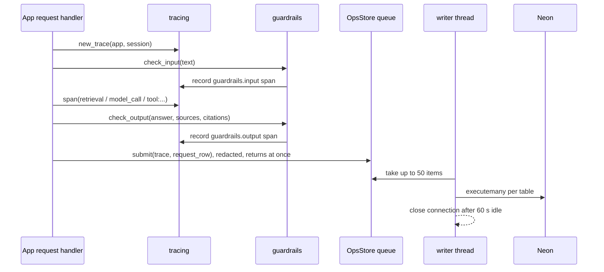
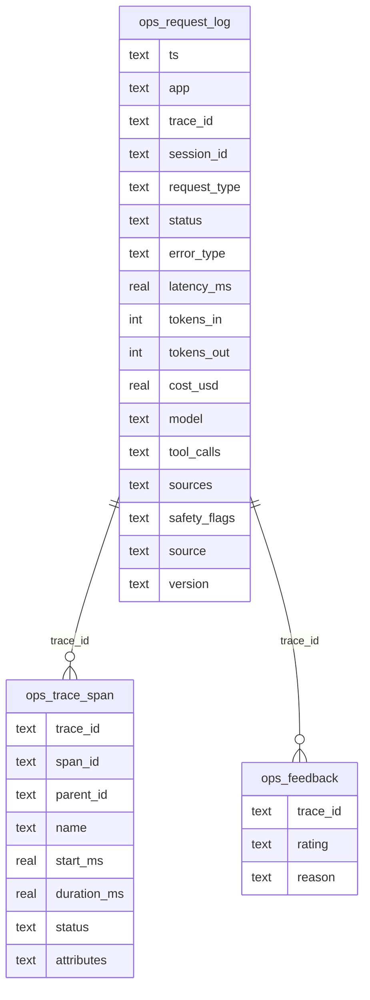

# Architecture

## Components

| Component | Responsibility | State |
|---|---|---|
| `guardrails` | Input and output verdicts; records each on the current trace; logs blocks | none (pure) |
| `injection` | Attack patterns; quarantine of retrieved text | none |
| `pii`, `secrets_mask` | Find and remove personal data; mask secrets | none |
| `language` | en / es / other, offline | none |
| `tracing` | One trace per request (context variable), spans with parents | per request, in memory |
| `oplog.OpsStore` | Queue → writer thread → Postgres / SQLite / JSONL; Admin reads; retention | one per app process |
| `jsonlog` | JSON lines on stdout | none |
| `admin_gate`, `admin_ui` | Password gate with lockout; Streamlit Admin page | lockout counters per process |
| `daily_summary` | Read-only daily error check for all apps | none |

## Request flow

## Tables

Status values: `ok`, `refused`, `blocked` (guardrail), `error`, `timeout`, `capped`. Source values: `user`, `eval`,
`keepawake` and `healthcheck` (these two are never written).

## Scaling path

1. Today: one writer thread per app process, one free Neon database shared by all apps.
2. More traffic: partition the tables by day and drop old partitions instead of `DELETE`.
3. Much more: replace the row writer with an OpenTelemetry exporter to a collector (the trace and span shapes
   already match), and keep `ops_request_log` as a small summary table.
